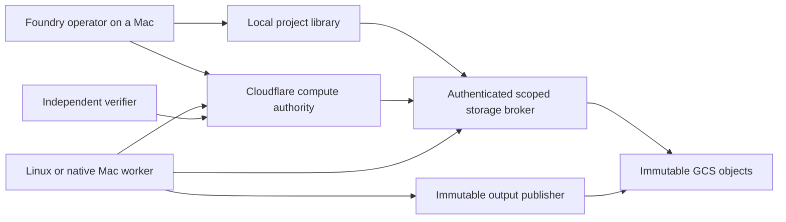

# Cloud-backed projects and remote builds

## Authority and storage boundaries

Cloudflare's existing compute Durable Object remains the command authority. New build tables share its storage transaction adapter, compute epoch, worker enrollment and authenticated identities. The new route is disabled unless `COMPUTE_BUILDS_ENABLED` and managed enrollment are explicitly enabled. No configuration flag was enabled here.

GCS preserves immutable objects; the Linux VM and Macs hold replaceable workspaces/caches. The fleet source catalog is a read model of captured variants, not a canonical repository or complete historical backup. An owner must approve input metadata after required assets, lockfiles, submodules, LFS and local dependencies are reconciled. A `reconstructable` approval is an accountable declaration; only later restore/build evidence validates it.

No cloud VM, account, daemon, credential or broker namespace was created. DigitalOcean retains existing responsibilities. Supabase remains a distinct data service; memory/models do not decide merges. MotionMix live controls, N'Ko, Vast lifecycle, stock Codex and other agent work are outside this route.

## Project and recipe contracts

Owner-approved inputs carry project identity, an immutable manifest reference, source snapshot identity, optional Git remote/revision/history status, required inputs and explicit missing inputs. Unknown readiness stays unknown. Changed work is captured separately, never overlaid into archived copies or promoted by timestamp.

Owner-approved profiles select `linux-build-v1` or `xcode-build-v1`, exact structured recipe, resource/disk/time limits, required output paths, and opt-in policy. Submitters select approved input/profile hashes; no job body supplies an executable or shell script. Linux images are digest pinned. Native Xcode selects `DEVELOPER_DIR` per job and disables signing. Project scripts still execute: only owner-approved trusted native projects are eligible, and account separation is not a hostile-code sandbox.

The runtime's local approval digest covers host account/paths/isolation settings and is distinct from the authority's portable build profile hash. Controller bindings must pin both; neither digest can be substituted for the other.

## Lifecycle and failure behavior

The authority owns one durable build slot per host; retained build slots also block legacy reservations. Worker census is sequence-fenced, server-timestamped and stale after 30 seconds. The existing enrollment freshness is checked separately. Placement explains class, liveness, owner profile approval, platform/toolchain, memory, disk and occupancy. Initial profiles require explicit worker opt-in for every host; the operator station receives a lower owner-configured preference without machine-name rules.

Jobs move QUEUED → RUNNING → VERIFYING → SUCCEEDED. Failed/cancelled/expired attempts retain stop uncertainty until actual stop evidence or explicit owner reconciliation. A 60-second lease renews at 15-second intervals and cannot exceed the profile's absolute duration (maximum one hour). Cancellation and renewal loss initiate host termination; expiry alone does not release a slot. Requeue is explicit, bounded and requires cleared stop uncertainty.

The host persists intent and runtime identity before activation. Restart uncertainty quarantines; it never reruns automatically. Native descendants require host evidence beyond a killed process group. Lack of evidence is a blocked result, not successful containment.

Artifacts and logs use immutable, generation-pinned references. Result manifests bind job, attempt, input and profile. Staging is not acceptance. Independent verification checks actual manifest/chunk bytes, complete required output paths, full-file hashes, bounds, lineage and current fences after asynchronous reads. Success verifies a build receipt, not app functionality, test quality, signing or release readiness.

## Capacity and retention

All hosts must retain at least 50 GiB beyond estimated job growth. Unknown estimates defer work. Initial scheduling permits one build per host. Mac1 is preferred as operator and needs explicit build opt-in; no machine receives a hard-coded task assignment. Pi remains census-only.

Managed reusable caches default to 20 GiB/Mac. Successful disposable workspaces are cleanup-eligible at 24 hours and failed workspaces at seven days, subject to ownership, inactivity and cleanup approval. Release archives/debug symbols and original project copies require separate retention/recovery decisions. Current inventory accepts **zero bytes as safe to delete**.

## Review status

This is local source implementation pending compilation/runtime validation. The master checklist and final review identify implemented versus blocked boundaries. Constructor DI ports are trusted host boundaries, not claims that a cloud provider/account/agent has been configured. No source archive is described as buildable merely because its hashes match.

## Initial bounded pilot versus estate coverage

The project library describes 585 catalog entries/589 captured versions, not 585 build-validated apps. All are discoverable in the captured collection; actual restore access is still gated. Legacy v1 build input snapshots retain their 128-file/128MiB ceiling. The 2026-10-18 continuation adds v2 segmented project inputs with packed small files: structural limits 8,192 selected files, 512 metadata segments, 4GiB source bytes, and 64MiB per file. Actual usable capacity is lower and must be admitted by a finite explicitly approved namespace set; every namespace retains 32 grants/8MiB. Authority approvals still permit at most 128 required paths. History/dependency/assets completeness is not inferred. See continuation-2026-10-18/PROJECT-INPUTS.md.

Initial portable build outputs/logs are capped at 7MiB total, 24 required paths and 31 chunks plus one manifest, fitting the hard 32-grant/8MiB fresh-namespace bounds. Existing usage must still pass real capacity admission; no namespace is silently rolled over or emptied. Approved app/debug/archive bundles are deterministic tar artifacts with explicit format and full artifact hashes; unsupported links/types and over-budget trees reject. A tar artifact is not proof that an app is runnable or distribution signed.

Apple's OCI-compatible Linux containers can help optional Mac development environments, but this source's Linux executor requires a Linux host. Native Xcode remains a distinct Mac profile. No Apple container tool was installed, invoked or treated as a substitute for macOS/Xcode.

## 2026-10-18 authority and native boundary

The existing synchronous broker remains a distinct mode. New online build namespaces persist their mode/namespace binding, durable scope approvals, exact-key reservation receipts, issuance intents, and separate deny/command delivery journals. The actual fixed-origin nonce-bound Cloudflare access observation runs before/after asynchronous reads and cached replies; no HTTP snapshot is retimestamped as a synchronous compute mirror. Local scope/policy/tombstone state is checked synchronously. A final successful online observation is the distributed authorization boundary; subsequent revocation cannot recall delivered bytes. Recoverable heartbeat denial fails the current read without a permanent tombstone. Only explicit irreversible fences produce retained revocations.

Native process lineage has opt-in Endpoint Security collector source plus a signed-journal verifier/client. No privileged companion or complete launchd/XPC/shared-service containment is delivered. No native stop path returns confirmed success, and placement explicitly reports `native-termination-attestation-not-supported`. Native release/activation remains blocked. No code exists here that converts a PID scan, process-group kill or signed assertion into complete termination proof.

## 2026-10-18 memory plane and retired orchestrator

Foundry is the only control plane. UCTM Studio (a fork of the open-source Agent Orchestrator, "AO") is retired to read-only history: its daemon is not running, its cron jobs were removed on Mac1 (crontab backup at `~/.fleet-backup/state-archive/crontab.pre-uctm-retire-20261018`), and agents run as Claude Code and Codex sessions that Foundry governs for builds and merges.

Agent memory has one home: the Supabase Memory project `zdcqqvvcpfpfyvbbfgsy`, fed by `ai-memory-runtime` (Mac1 launchd `com.mohameddiomande.ai-memory-runtime`). It collects user/assistant turns and embeddings from AO, Claude Code, Codex, Muse, Mac2/Mac4/Mac5 native sessions, the Foundry host/app, and K11 historical turns. All 22,272 AO messages were verified present (outbox cursor equals the AO table's max rowid). The `foundry-memory` MCP searches these turns first and falls back to the K11 archive. Foundry's Cloudflare D1 decisions remain the formal governance record; Supabase Memory is the searchable recall layer, not an authority. The legacy prompt-logger sync to the Main project (`aaqbofotpchgpyuohmmz`, no longer resolvable) is disabled.

Storage tiers: local disks hold the working set only; Supabase holds the index (Motion for capture, Memory for agents); `gs://fleet-backup-648527652351` holds verified cold archives, including the full AO database (`mac1/state/2026-10-18/`) and the 2026-10-18 fleet project archives; Drive `MotionMix-Central` holds media. K11 is compute, not storage. Apple's container tool is not adopted; its Mac1 storage was removed.

## 2026-10-19 LUME stage and K11 body plane

Machine roles, amended:

| Machine | Role | Foundry relation |
| --- | --- | --- |
| Mac1 | operator workstation, live MotionMix hub | operator station |
| Mac4 | LUME stage: Femto Mega, Unity DYK projector, web fluid lab; build worker | Mac VM build worker when the stage is idle |
| Mac5 | build worker | primary Mac VM build worker |
| K11 | LUME/Air Deck body plane (5 NSSM services) and GPU render/batch | external batch facility for render jobs only |

The live loops on Mac1, Mac4 and K11 are outside Foundry: Foundry owns code, builds and
governed batch jobs, never a stage service. The LUME stage code and both machines' service
definitions live in github.com/Diomandeee/lume-commerce (stage/mac4, stage/k11, infra/k11,
infra/launchagents/mac4, infra/launchdaemons/mac4; map in infra/STAGE-MAP.md). Before
2026-10-19 none of the K11 code and none of the Mac4 runtime was in Git.

K11 data not yet covered by any archive: C:\lume\data\body_motion.sqlite3 (117 GB, the Air
Deck bridge records every pose frame), C:\lume\voice (73 GB), C:\lume\stems (28 GB),
C:\lume\airdeck\sessions (15 GB). A retention rule for body_motion is an open decision.
