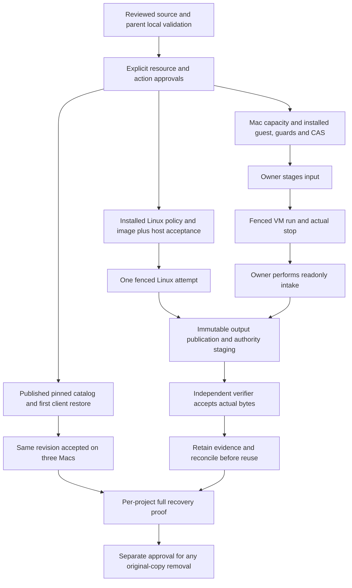

# R7 activation readiness and operator handoff

**Last updated:** 2026-10-18T17:26:56Z  
**Disposition:** activation HOLD; requirements and conditional procedures prepared, no operational approval or execution.  
**Source:** `/Users/mohameddiomande/Developer/foundry-integration/source`, branch `codex/foundry-integration-20261016`, observed HEAD `cf27ac662730bb98a509af8d1d1ebea4342eef7a`; shared dirty tree. References describe working files, not just HEAD. Concurrent changes require a fresh byte-bound acceptance receipt before use.

This lane reviewed source/configuration/documentation and writes only this file. Parent authorization permits scoped local compilation/tests/repair with existing dependencies; this documentation lane ran **no tests or compilation**. Installation, provisioning, remote/cloud/SSH operations, spend, secret reads/changes, services, helpers, VMs, mounts, real Docker, deployment, publication, commits/push/merge and cleanup remain outside authorization. No cron. Generic “continue” and `allowActivation` flags do not approve those actions. The parent owns `ROUTE.json` and overall validation status; neither is changed here.

## Decision and R7 reconciliation

The current code supplies a concrete **single-attempt Linux pilot** and an **owner-mediated Apple Silicon VM build path**. It does not supply an installed fleet, an unattended reusable worker service, or proof that captured projects are complete. Local fake-dependency tests can validate contracts and failure handling; they cannot establish kernel containment, real user-namespace mappings, AppArmor enforcement, VM termination, mounted filesystem immutability or provider authorization.

| R7 item | Concrete prerequisite and acceptance | Current disposition |
| --- | --- | --- |
| R7.1 validation | Parent's current scoped compiler/test results, then separately approved actual-host containment/restore/build acceptance | Local validation authorized to parent; operational acceptance still gated. No test result claimed here. |
| R7.2 catalog, first client, three Macs | Approved distribution object with real generation/hash, exact client revision/transport/paths, first restore evidence, then Mac1/Mac4/Mac5 rollout | Prepared catalog is not published evidence; installation, reads, activation and publication unapproved. |
| R7.3 Linux resource/worker | Approved cloud target, quote/budget/network/IAM, installed host policies and images, controller integration, one independently verified build | Proposal only; actual resource and activation receipts absent from reviewed material. |
| R7.4 Mac headroom | Fresh per-volume observations and explicit path-specific regenerable-data cleanup approval, or separately approved capacity | Historical observations are below required reserve; no reclaimable bytes accepted. No cleanup authorized. |
| R7.5 first Mac, second Mac | Qualified Apple Silicon guest/image/helper/CAS configuration, owner stage/intake, verified unsigned build; repeat acceptance on second host | Manual bridge and per-host evidence required. Native host Xcode launch denied. |
| R7.6 originals | Per-copy complete recovery proof, dependencies/history/held-input decisions and explicit deletion/recovery plan | Source-only archive integrity cannot satisfy this gate. Originals retained. |
| R7.7 receipts | Resource IDs, identities/epochs/revisions, policy/source/installed hashes, real job/stop/storage/verification records, quota and retention decisions | Operator must produce receipts during separately authorized operations. |

Evidence: [MASTER-CHECKLIST.md:53](/Users/mohameddiomande/Developer/foundry-integration/source/docs/cloud-workspaces/MASTER-CHECKLIST.md:53), [independent review README.md:41](/Users/mohameddiomande/Developer/foundry-integration/source/docs/cloud-workspaces/independent-review-2026-10-18/README.md:41), [controller.ts:74](/Users/mohameddiomande/Developer/foundry-integration/source/packages/build-runtime/src/controller.ts:74). Earlier “no tests authorized” statements are historical; they do not override the current bounded local authorization. Earlier generic Linux writable-storage and Mac CAS gaps are superseded only for the supplied concrete adapters, not for arbitrary materializers.

## Supported flow versus the end goal



| Surface | Implemented supported behavior | What remains outside that claim |
| --- | --- | --- |
| Library bridge | Frozen source variants, generation/hash-pinned pulls, new destination only; explicit CLI snapshot of selected source | Transactional library enrollment, canonical promotion, automatic save-back/live sync, complete Git/dependency/assets/secret backup |
| Linux | Native x64/arm64, preloaded digest image, offline npm/cargo/CMake; private root broker; actual scoped input/publication ports | Arbitrary interactive execution, network dependency fetching, Apple bundles/signing; automatic second attempt or resource reclamation |
| Mac | Apple Silicon VM, offline unsigned Xcode, verified readonly input and stop-gated intake, concrete root CAS | Direct native host project launch, unattended image hydration/stage/intake, signing/TestFlight/distribution, automatic cleanup |
| Build result | Stop evidence → publication/readback → stage → independent verification | Submission acknowledgement, helper exit 0, VM stop or upload alone are not successful build acceptance |
| Fleet | Factories and operator routes exist | A configured host launcher/service, current per-host installed resources and real operating receipts remain necessary |

Portable outputs remain **1–24 selected paths, 7 MiB combined output/archive/log bytes, 31 chunks plus one manifest**, with objects at most 1 MiB. Linux input is at most 8,192 files / 2 GiB / 64 MiB per file; Mac pilot is at most 1,024 files / 2 GiB / 64 MiB per file. Authority required-input lists remain at most 128 paths. Generic format ceilings do not enlarge these composed limits. Evidence: [build-runtime/README.md:32](/Users/mohameddiomande/Developer/foundry-integration/source/packages/build-runtime/README.md:32), [Linux scope:26](/Users/mohameddiomande/Developer/foundry-integration/source/docs/cloud-workspaces/linux-isolation-2026-10-18/README.md:26), [Mac scope:43](/Users/mohameddiomande/Developer/foundry-integration/source/docs/cloud-workspaces/vm-integration-2026-10-18/README.md:43).

## Approval matrix by resource and action

All “required” approvals below are **ungranted by this task**. An approval packet must name the resource, host/environment, exact action, candidate hashes, bounded duration/capacity, identity references, rollback owner and retained evidence. Approval of a resource does not approve every action against it. No credential value belongs in this report or a command line.

| Resource / action | Concrete candidate or binding | Separate approval and missing facts |
| --- | --- | --- |
| Local validation | Existing `node_modules`, pure/temp/fake dependencies | Parent authorized; this lane read-only. Real OS/service acceptance is separate. |
| GCP VM and disks | Project `project-8380e794-e4d6-4ad4-aaf`, zone `us-east1-b`, `foundry-linux-pilot-01`, proposed `e2-standard-2`, 2 vCPU/8 GiB; 30 GiB boot + 100 GiB workspace `pd-balanced`, auto-delete false | Approve exact immutable OS image, instance/disk identities, labels, placement, provisioning and shutdown authority. Proposal is not proof the machine exists or qualifies. |
| Billing / duration | Proposal says seven-day pilot and USD 50 envelope, `budgetApproved:false` | Obtain current account-specific quote, credit balance/expiry, disk/network/object/logging costs and approved limit. This review obtained no quote and repeats no rate estimate. Budget alerts are not a hard cap. |
| Connectivity / IAM | No public application ingress; approved private access; explicit egress to necessary services | Approve exact VPC/subnet/firewall/egress choice and dedicated service identity/permissions. Existing egress, external IP or NAT cannot be assumed. Tailscale installation/access is separate. |
| Cloudflare authority and schema | Selected existing account/environment/service/SQLite DO namespace; preserve issuer/environment/managed binding | Approve target-specific deployment/migration and rollback plan. Candidate TOML is deny-all/unactivated; no real target mapping is established here. |
| Gate policy / D1 | `VERIFY_REQUIRE_CHECKED`, verifier endpoint, exact dev/staging/production DB | Explicit G3 choice, independently trusted verifier policy, schema inspection/backup/additive migration and deployment required. See next section. |
| Broker/provider namespaces | Exact project/bucket/object prefixes, durable namespace IDs, principal/fence, issuer/writer/reader/capacity mapping | Approve provider access, grant issuance, cumulative budgets and publication/read operations; no automatic new namespace to bypass exhaustion. |
| Catalog object publication | Prepared r3 distribution, immutable revision and object generation | Approve create-only destination and source hash; record actual generation/size/hash. Source-copy upload authorization is not catalog publication approval. |
| Library clients | Per-Mac client/catalog/cache/workspace paths; loopback port 9148 | Approve installation, chosen direct/SSH/broker transport, foreground activation and exact trial restore destination. No launch agent supplied. |
| Identities / secrets | Distinct owner/submitter/verifier/enrolled executor and operator-session identities; opaque references | Approve issuance/delivery/rotation/revocation and exact principal/revision/incarnation. No operator key copying; no secret reads in this lane. |
| Linux accounts/runtime | Dedicated controller UID/GID; container and mapped IDs; root broker, Docker/AppArmor/cgroup/ext4 policy | Approve accounts/subordinate ranges, executable installs, daemon configuration, image preload, privileged directories/mounts and broker activation. Never alter a shared Docker socket to make checks pass. |
| Mac runtime/images | Dedicated controller, signed VM helper/entitlement, readonly guard, isolated Python/CAS, guest/source/capability images | Approve exact per-host binaries, interpreter/stdlib, signing identity, image provenance/pins, directories, mounting, root CAS start, each stage/intake and VM start/stop. No broad sudo/service policy implied. |
| Build admission / verification | Exact input/profile/worker approval, Mac `approveVm`, job and result namespace | Approve one bounded disposable job and real verifier operation; distinguish build API from legacy short-job API. Host `allowActivation` and UI flags express configuration, not consent. |
| Recovery / revocation / shutdown | Exact active attempt, host slot, broker/service PID and resource IDs | Approve stop/reconcile/revocation or cloud shutdown against real observed identity; cancellation alone is not containment proof. Retain all durable history. |
| Space recovery / originals | Explicit named regenerable paths or individual original copy | Separate path-specific approval with inactivity/ownership/recovery evidence. None named/approved here. No blanket cache eviction, socket deletion, mount detach, disk deletion or originals cleanup. |

Sources: [RESOURCE-PROPOSAL.json:2](/Users/mohameddiomande/Developer/foundry-integration/source/docs/cloud-workspaces/RESOURCE-PROPOSAL.json:2), [ACTIVATION-AND-COST.md:15](/Users/mohameddiomande/Developer/foundry-integration/source/docs/cloud-workspaces/ACTIVATION-AND-COST.md:15), [compute.pilot.toml:1](/Users/mohameddiomande/Developer/foundry-integration/source/tools/foundry-pilot/compute.pilot.toml:1), [worker identity contract:41](/Users/mohameddiomande/Developer/foundry-integration/source/workers/compute/README.md:41).

## G3, database and catalog gates

### G3 is a policy decision, not another missing predicate

`blocksMerge(v, enforce, requireChecked)` blocks when `requireChecked && (!v.checked || !v.ok)` or `enforce && v.checked && !v.ok`. `VERIFY_REQUIRE_CHECKED=1` is the positive-evidence switch. `VERIFY_ENFORCE=1` alone does **not** refuse unchecked verification. With no `VERIFY_URL`, the pipeline supplies `{checked:false, ok:true, runs:[]}`. The strict switch therefore refuses that result; default advisory policy permits it if other admission checks succeed. [verify/index.ts:136](/Users/mohameddiomande/Developer/foundry-integration/source/packages/verify/src/index.ts:136), [gate/index.ts:37](/Users/mohameddiomande/Developer/foundry-integration/source/workers/gate/src/index.ts:37), [pipeline.ts:88](/Users/mohameddiomande/Developer/foundry-integration/source/workers/gate/src/pipeline.ts:88).

Recommended protected-target decision remains strict checked-positive verification with an approved verifier. This report does not choose or apply a production policy for the owner. The approval packet needs the exact target, chosen flags, verifier endpoint/required-check semantics and evidence that the verifier evaluates the intended proposal. Persisted verifier responses bind the proposal/content/policy; they do not independently prove that remote checks executed. G3 remains owner-policy-pending. [INHERITED-FINDINGS.json:85](/Users/mohameddiomande/Developer/foundry-integration/source/docs/cloud-workspaces/independent-review-2026-10-18/INHERITED-FINDINGS.json:85), [verification-receipt.ts:9](/Users/mohameddiomande/Developer/foundry-integration/source/workers/gate/src/verification-receipt.ts:9).

### Existing schema must be inspected before any approved migration

Gate D1 needs both `decisions.verification` and `verification_receipts` with immutable update/delete triggers. `CREATE TABLE IF NOT EXISTS decisions` does not add a missing column. Candidate SQL documents `ALTER TABLE decisions ADD COLUMN verification TEXT;` **only if absent**, not a blind repeatable migration. Receipt write/readback happens before merge and missing storage holds the pipeline. [schema.sql:19](/Users/mohameddiomande/Developer/foundry-integration/source/workers/gate/schema.sql:19), [schema.sql:41](/Users/mohameddiomande/Developer/foundry-integration/source/workers/gate/schema.sql:41), [decisions.ts:207](/Users/mohameddiomande/Developer/foundry-integration/source/packages/stores/src/decisions.ts:207).

The approved migration procedure must first identify the actual target DB, capture a verified backup and before-schema, then conditionally add the column, apply missing additive receipt objects, verify after-schema and compatibility before deploying. Read-only SQL to include in that future packet is `PRAGMA table_info(decisions);` and `SELECT type,name,sql FROM sqlite_master WHERE name IN ('decisions','verification_receipts','verification_receipts_no_update','verification_receipts_no_delete');`. Neither query was executed. No exact `wrangler` migration command is approved: the target environment and before-state remain unobserved. The config has three distinct DB bindings, despite an older placeholder comment. [wrangler.toml:11](/Users/mohameddiomande/Developer/foundry-integration/source/workers/gate/wrangler.toml:11), [migration acceptance:11](/Users/mohameddiomande/Developer/foundry-integration/source/docs/cloud-workspaces/writable-integration-2026-10-18/DEFERRED-ACCEPTANCE.md:11).

Compute DO state is separate from gate D1. Managed enrollment cannot be disabled after entry into managed mode; existing pre-metadata/incompatible fleet state rejects. Build schema adds immutable records and exclusive-host constraints; creation statements are not an approved upgrade or restore plan for older state. Preserve actual namespace/environment/authority/issuer identities and all history. Do not recreate a database or downgrade managed mode as rollback. [compute/authority.ts:59](/Users/mohameddiomande/Developer/foundry-integration/source/workers/compute/src/authority.ts:59), [build-jobs/schema.ts:1](/Users/mohameddiomande/Developer/foundry-integration/source/packages/build-jobs/src/schema.ts:1).

### Catalog completeness and delivery are separate gates

The recorded r3 revision is `47c1a94efec4584c69f5aaec4856e40c3789e80de555eb878e12976d11e1f127`. Documentation records 585 directory/project entries, 457 with source, 128 without source, 589 versions and 38 requiring explicit version choice. These are historical assembly observations, not refreshed counts or unique application totals. The 12,094,956-byte prepared catalog archive has an unpublished descriptor, not a real object generation. [bridge README.md:9](/Users/mohameddiomande/Developer/foundry-integration/source/tools/foundry-library-bridge/README.md:9), [distribution:178](/Users/mohameddiomande/Developer/foundry-integration/source/tools/foundry-library-bridge/README.md:178).

Before approving each project, resolve exact catalog/version, required inputs, Git lineage/history expectations, held/unavailable inputs, assets, generated source, offline dependencies, toolchain, recipe/targets and output fit. The source inventory says every project's build readiness is unestablished. Successful delivery does not change that. Input preparation can deliberately return `reconstructable:false`; the build authority refuses preview/submission until an owner-approved reconstructable input with no missing paths exists. No declaration or empty missing list is substitute evidence. [R1-REVIEW.md:43](/Users/mohameddiomande/Developer/foundry-integration/source/docs/cloud-workspaces/R1-REVIEW.md:43), [PROJECT-INPUTS.md:215](/Users/mohameddiomande/Developer/foundry-integration/source/docs/cloud-workspaces/continuation-2026-10-18/PROJECT-INPUTS.md:215), [authority.ts:33](/Users/mohameddiomande/Developer/foundry-integration/source/packages/build-jobs/src/authority.ts:33), [authority.ts:109](/Users/mohameddiomande/Developer/foundry-integration/source/packages/build-jobs/src/authority.ts:109).

Whole fleet archives and this catalog exceed the scoped broker's 1 MiB object/read bound; its 32 lifetime grants / 8 MiB payload / 128 lifetime reads per namespace remain finite. An explicit chunk publication and real durable namespace/grant/capacity plan is required for broker delivery. Direct gcloud and existing Mac1 SSH read-through are separate explicit choices, not denial fallbacks. The CLI's direct/SSH transport and embedded broker DI are different integrations; do not invent a broker CLI flag. [bridge README.md:89](/Users/mohameddiomande/Developer/foundry-integration/source/tools/foundry-library-bridge/README.md:89), [capacity gate:99](/Users/mohameddiomande/Developer/foundry-integration/source/tools/foundry-library-bridge/README.md:99).

## Required installation contract: Linux

These are source-enforced paths and policies, **not an inventory of installed resources**.

| Resource | Required path / policy | Source evidence |
| --- | --- | --- |
| Root namespace | `/var/lib/foundry-linux`, `attempts/`, empty `docker-config/`; canonical, root-owned private ACL-free directories | [load_policy:106](/Users/mohameddiomande/Developer/foundry-integration/source/packages/build-runtime/native/linux-isolation.py:106), [attempt:275](/Users/mohameddiomande/Developer/foundry-integration/source/packages/build-runtime/native/linux-isolation.py:275) |
| Root policy | `/var/lib/foundry-linux/policy.json`, bounded private regular single-link file; exact version/controller/build/mapped IDs, disk/reserve sizes, executable hashes, profiles, `apparmorCompiledSha256` | [load_policy:110](/Users/mohameddiomande/Developer/foundry-integration/source/packages/build-runtime/native/linux-isolation.py:110) |
| Client executable pins | `/usr/bin/python3.12`; `/usr/local/libexec/foundry-linux-isolation.py`; actual installed SHA-256 for each | [linux-isolated-client.ts:6](/Users/mohameddiomande/Developer/foundry-integration/source/packages/build-runtime/src/linux-isolated-client.ts:6) |
| Root executable pins | `/usr/bin/docker`, `/usr/sbin/mke2fs`, `/usr/bin/mount`; canonical root-owned non-writable/ACL-free paths and actual hashes | [load_policy:126](/Users/mohameddiomande/Developer/foundry-integration/source/packages/build-runtime/native/linux-isolation.py:126) |
| Runtime sockets/census | Root-only `/run/docker.sock`; root-controlled `/run/foundry-linux`; broker creates `broker.sock` root:controllerGid 0660 and `census.json` readonly | [socket validation:134](/Users/mohameddiomande/Developer/foundry-integration/source/packages/build-runtime/native/linux-isolation.py:134), [census:228](/Users/mohameddiomande/Developer/foundry-integration/source/packages/build-runtime/native/linux-isolation.py:228), [server:674](/Users/mohameddiomande/Developer/foundry-integration/source/packages/build-runtime/native/linux-isolation.py:674) |
| AppArmor | `/etc/apparmor.d/foundry-linux-build-v1` exactly matches pinned include-free source; enabled module, global/profile enforce, root namespace, ptrace read/trace, exported loaded-policy SHA matches approved compiled hash | [apparmor_policy:158](/Users/mohameddiomande/Developer/foundry-integration/source/packages/build-runtime/native/linux-isolation.py:158) |
| Cgroup | `/sys/fs/cgroup/foundry-builds`, root-controlled v2 domain with cpu/memory/pids; actual kill/freeze controls and initially empty/unfrozen events | [attempt:285](/Users/mohameddiomande/Developer/foundry-integration/source/packages/build-runtime/native/linux-isolation.py:285) |
| Docker/image | CLI and Engine 25+; daemon userns remapping; cgroupfs, seccomp/limits support, native architecture, preloaded digest image/no volumes; empty container `UsernsMode` uses daemon default | [server:679](/Users/mohameddiomande/Developer/foundry-integration/source/packages/build-runtime/native/linux-isolation.py:679), [container:483](/Users/mohameddiomande/Developer/foundry-integration/source/packages/build-runtime/native/linux-isolation.py:483), [checks:507](/Users/mohameddiomande/Developer/foundry-integration/source/packages/build-runtime/native/linux-isolation.py:507) |
| Dedicated identity | Controller UID/GID distinct from build UID/GID and mapped IDs; build IDs 1000–65535; mapped IDs 65536–2147483647 established from actual subordinate mapping | [load_policy:117](/Users/mohameddiomande/Developer/foundry-integration/source/packages/build-runtime/native/linux-isolation.py:117) |
| Workspace capacity | Dedicated filesystem at broker namespace; fixed preallocated ext4 image 256 MiB–8 GiB, multiple of 4096; reserve at least 50 GiB plus source/work/capture/metadata and inode requirements | [load_policy:123](/Users/mohameddiomande/Developer/foundry-integration/source/packages/build-runtime/native/linux-isolation.py:123), [attempt:273](/Users/mohameddiomande/Developer/foundry-integration/source/packages/build-runtime/native/linux-isolation.py:273) |
| Controller roots | Owner-chosen distinct canonical private `inputBase`, `workBase`, `journalRoot`; actual dedicated nonroot UID/GID, `allowActivation`; transport/enrollment/sequence/profile/storage pins | [types.ts:11](/Users/mohameddiomande/Developer/foundry-integration/source/packages/build-runtime/src/types.ts:11), [host.ts:7](/Users/mohameddiomande/Developer/foundry-integration/source/packages/build-runtime/src/host.ts:7), [worker factory:7](/Users/mohameddiomande/Developer/foundry-integration/source/packages/build-runtime/src/linux-isolated-worker.ts:7) |

The root profile map is keyed by **local recipe hash**, not server profile hash. `linuxIsolationProfile` produces data for review; it installs nothing. Installation must bind actual daemon/subordinate mapping, mapped filesystem ownership, include-free AppArmor source → parser/features → compiled payload → loaded digest and image/executable pins. Source hashes cannot be substituted for compiled/binary hashes. The root-only Docker socket and non-symlink requirements may conflict with an ordinary host layout; resolve a dedicated approved arrangement instead of weakening checks.

The conservative source-copy admission also matters: 8,192 empty flat files can require about 306 MiB in the bound and fail a 256 MiB image's 224 MiB allowance. No automatic disk enlargement exists. Real-host acceptance must exercise remapped host procfs access, AppArmor enforcement, cgroup freeze/kill/delayed launch and whole-ext4 readonly remount with retained writers; output capture requires readonly **superblock**, not merely a readonly bind mount. [independent review README.md:21](/Users/mohameddiomande/Developer/foundry-integration/source/docs/cloud-workspaces/independent-review-2026-10-18/README.md:21), [capture:590](/Users/mohameddiomande/Developer/foundry-integration/source/packages/build-runtime/native/linux-isolation.py:590), [DEFERRED-ACCEPTANCE.md:7](/Users/mohameddiomande/Developer/foundry-integration/source/docs/cloud-workspaces/independent-review-2026-10-18/DEFERRED-ACCEPTANCE.md:7).

## Required installation contract: Mac

| Resource | Required path / policy | Source evidence |
| --- | --- | --- |
| VM host helper | `/Library/Foundry/bin/mac-vm-host`, actual installed helper hash and owner-approved signed build; virtualization entitlement | [adapter.ts:22](/Users/mohameddiomande/Developer/foundry-integration/source/packages/build-runtime/src/mac-vm-adapter.ts:22), [entitlements:5](/Users/mohameddiomande/Developer/foundry-integration/source/packages/build-runtime/native/mac-vm-host.entitlements:5) |
| Readonly guard | `/Library/Foundry/bin/mac-tree-guard`, compiled installed hash; real readonly local volume identity, root-owned ACL-free ancestry | [mailbox.ts:50](/Users/mohameddiomande/Developer/foundry-integration/source/packages/build-runtime/src/mac-vm-mailbox.ts:50), [mac-tree-guard.c:172](/Users/mohameddiomande/Developer/foundry-integration/source/packages/build-storage/native/mac-tree-guard.c:172) |
| CAS runtime | `/Library/Foundry/bin/cas-python` and `/Library/Foundry/bin/mac-cas.py`, actual installed hashes and owner-trusted interpreter/stdlib | [mac-isolated-store.ts:10](/Users/mohameddiomande/Developer/foundry-integration/source/packages/build-storage/src/mac-isolated-store.ts:10), [mac-cas.py:347](/Users/mohameddiomande/Developer/foundry-integration/source/packages/build-storage/native/mac-cas.py:347) |
| CAS state | `/Library/Foundry/CAS/policy.json`, private `objects/`, root-controlled `run/` 0755, `run/store.sock` root:workerGid 0660; exact kernel peer UID required | [mac-cas.py:19](/Users/mohameddiomande/Developer/foundry-integration/source/packages/build-storage/native/mac-cas.py:19), [policy:314](/Users/mohameddiomande/Developer/foundry-integration/source/packages/build-storage/native/mac-cas.py:314), [serve:351](/Users/mohameddiomande/Developer/foundry-integration/source/packages/build-storage/native/mac-cas.py:351) |
| CAS limits | Policy version, workerUid/Gid (at least 501), maxBytes ≤20 GiB, maxObjects ≤200,000, reserveBytes ≥50 GiB; actual partial objects count | [policy:321](/Users/mohameddiomande/Developer/foundry-integration/source/packages/build-storage/native/mac-cas.py:321) |
| Source/capability | Explicit snapshot-bound readonly source under `/Library/Foundry/VM/sources/`; readonly `/Library/Foundry/VM/capabilities/<canonical-capability-hash>/capability.json` | [staging.ts:20](/Users/mohameddiomande/Developer/foundry-integration/source/packages/build-runtime/src/mac-vm-staging.ts:20), [capability.ts:12](/Users/mohameddiomande/Developer/foundry-integration/source/packages/build-runtime/src/mac-vm-capability.ts:12) |
| Per-attempt artifacts | `/Library/Foundry/VM/attempts/<attemptId>/boot.raw`, `outputs.raw`, `auxiliary.bin`, `hardware-model.bin`, `machine-identifier.bin`, readonly `input/`, later `intake/`, root-owned `receipts/` | [adapter.ts:90](/Users/mohameddiomande/Developer/foundry-integration/source/packages/build-runtime/src/mac-vm-adapter.ts:90), [host.swift:231](/Users/mohameddiomande/Developer/foundry-integration/source/packages/build-runtime/native/mac-vm-host.swift:231) |
| Artifact ownership | Root-owned ACL-free canonical ancestors; writable boot/output/aux files controller-owned 0600; hardware/model files root-owned 0444. Raw disks fully allocated, non-sparse, noncompressed; boot ≤128 GiB, output ≤8 GiB | [host.swift:198](/Users/mohameddiomande/Developer/foundry-integration/source/packages/build-runtime/native/mac-vm-host.swift:198), [adapter.ts:53](/Users/mohameddiomande/Developer/foundry-integration/source/packages/build-runtime/src/mac-vm-adapter.ts:53) |
| Owner I/O tool | Source `packages/build-runtime/native/mac-vm-io.py`; approved installed location/interpreter not fixed by mailbox. Explicit root invocation with exact request SHA and bytes on stdin | [mac-vm-io.py:448](/Users/mohameddiomande/Developer/foundry-integration/source/packages/build-runtime/native/mac-vm-io.py:448), [mailbox.ts:10](/Users/mohameddiomande/Developer/foundry-integration/source/packages/build-runtime/src/mac-vm-mailbox.ts:10) |
| Guest | Owner-provisioned boot image, compatible hardware/machine/aux data, installed runner, exact macOS/Xcode/SDK/developer directory and offline dependencies | [VM integration README.md:33](/Users/mohameddiomande/Developer/foundry-integration/source/docs/cloud-workspaces/vm-integration-2026-10-18/README.md:33), [guest.py:299](/Users/mohameddiomande/Developer/foundry-integration/source/packages/build-runtime/native/mac-vm-guest.py:299) |

`approveVm` is separate from enrollment and profile approval: it binds worker revision, profile hash, capability and `activationEvidenceHash`; it is owner attestation, not automatic guest attestation. Changing capability requires a new approved enrollment revision. Guest observation must happen in the actual approved guest, then bind the offline boot hash and installed helpers. A host Xcode plist does not qualify the guest. [authority.ts:95](/Users/mohameddiomande/Developer/foundry-integration/source/packages/build-jobs/src/authority.ts:95), [VM integration README.md:35](/Users/mohameddiomande/Developer/foundry-integration/source/docs/cloud-workspaces/vm-integration-2026-10-18/README.md:35).

Historical free-space observations were approximately 6.424/16.514/17.594 GiB on local/Mac4/Mac5, all below the build reserve; they are not current measurements. The authority requires free bytes minus estimated additional bytes ≥50 GiB; Mac guest RAM additionally needs 1 GiB host headroom. Count boot/output/intake copies, retained attempts, CAS and source images on their actual volumes; do not add APFS shared free-space reports or interpret `du` as reclaimable space. Unknown storage blocks admission. [R1-REVIEW.md:57](/Users/mohameddiomande/Developer/foundry-integration/source/docs/cloud-workspaces/R1-REVIEW.md:57), [authority.ts:62](/Users/mohameddiomande/Developer/foundry-integration/source/packages/build-jobs/src/authority.ts:62).

## Runbook: prepare and approve progressive activation

**When**: Parent local validation has a current candidate receipt and the owner requests a concrete operational approval packet. This is the ordered plan for future work; none of its operational steps ran here.

**Steps**:

1. Bind the candidate to a fresh dirty-tree manifest, parent validation commands/results and the bounded independent-review findings. Reuse [independent acceptance](../independent-review-2026-10-18/DEFERRED-ACCEPTANCE.md), [Linux acceptance](../linux-isolation-2026-10-18/DEFERRED-ACCEPTANCE.md), [VM acceptance](../vm-integration-2026-10-18/DEFERRED-ACCEPTANCE.md) and [storage/schema acceptance](../writable-integration-2026-10-18/DEFERRED-ACCEPTANCE.md). Expected result: source identity and exact untested OS/provider cases recorded; no generic “all validated” label.
2. Resolve G3, selected Cloudflare targets, existing schema/backup/migration plan, finite broker routes and per-project completeness. Approve cloud cost/network/IAM/resource plan before provisioning. **Stop** at any unspecified target, policy, quote, image, identity or recovery ownership; do not fill it with plausible defaults.
3. Obtain separate installation, schema/deployment, identity, publication and operational-acceptance approvals from the matrix. Preserve legacy route/issuer/managed bindings. Apply only approved additive migrations and compatible deployment, with submission/host activation still disabled. Expected result: real before/after and installed-resource receipts. This document supplies no approved cloud/install command.
4. Publish the approved catalog create-only; record the actual object generation/hash and published descriptor. Install and activate one client using the runbook below; accept its restore, then separately activate the other two. This establishes delivered-source access only.
5. Provision the single approved Linux resource and install the reviewed exact Linux contract. Run separately authorized actual-host acceptance, including negative containment cases, before a real project attempt. Do not substitute parent fake tests for this step.
6. Complete the host integration packet: executable controller launcher, stop/abort interface, exact `LinuxIsolatedWorkerConfig` or `MacVmWorkerConfig`, host roots/pins, durable sequence baselines, approved input and result storage resolvers, and the independent build-verifier operator entrypoint. **Currently blocked:** no non-test caller of either controller factory was found in `packages`, `tools` or `workers`; only factory definitions/exports/documentation. No systemd/launchd/install recipe was found in the inspected runtime/storage/pilot paths. The old `worker-host.ts`/`verifier-host.ts` commands serve the legacy short-job flow. A tested controller CLI/service and build-verifier invocation must be supplied/reviewed, or an explicit owner-operated embedding program must be accepted. No fabricated start command is provided here.
7. With managed enrollment and build transport explicitly approved, pin the actual authority/environment/epoch and worker revision/incarnation. Send owner approvals in order: enrollment → `approveInput` and `approveProfile` → `approveWorker`; on Mac add `approveVm`. The build envelope is `POST /v1/builds/commands` with `{expectedEpoch, command:{operation,key,body}}`. Use persisted exact keys/bodies and approved credential-reference transport. `COMPUTE_BUILDS_ENABLED=true` needs managed enrollment; independent byte verification also needs approved `BUILD_BROKER_ORIGIN` and `BUILD_BROKER_CREDENTIAL` bindings. Never run a raw bearer-bearing curl command from this document. Expected result: actual immutable approval hashes, not guessed revisions. [compute/authority.ts:60](/Users/mohameddiomande/Developer/foundry-integration/source/workers/compute/src/authority.ts:60), [build API:126](/Users/mohameddiomande/Developer/foundry-integration/source/workers/compute/src/authority.ts:126), [approval order:95](/Users/mohameddiomande/Developer/foundry-integration/source/packages/build-jobs/src/authority.ts:95).
8. Start one approved Linux broker and invoke one controller run/poll through the reviewed launcher, following the Linux runbook. Accept only the real stopped/publication/stage/independent-verification chain. Retain its slot/resources; do not immediately schedule a second job.
9. Establish fresh Mac headroom through separately approved capacity or explicitly named regenerable cleanup. Install/qualify the Mac contract, approve its capability and perform one owner-mediated unsigned build. Accept one host before proposing a second; each host needs its own evidence.
10. Record actual client revision/restore, job/attempt/worker/epoch/profile/input, cgroup or VM stop, publication generations/grants, independent verification and capacity/retention receipts. Keep K11 Craft and its natural canary external; this route does not enroll or activate it. Request original-copy removal only after per-copy full recovery proof and separate explicit authorization.

**Rollback**: Use the stop-and-preserve runbook below; source rollback alone neither stops execution nor reverses persisted authority state.

**Escalation**: Alert Mo before any missing resource/action approval, unexplained identity/schema drift, unsupported project bounds, failed containment/stop or insufficient capacity. Stop progression at the affected step; retain evidence.

## Runbook: publish and activate the first library client

**When**: Exact catalog publication, client installation, read transport, destination and foreground-service activation are separately approved.

**Steps**:

1. Reuse [bridge activation commands:158](/Users/mohameddiomande/Developer/foundry-integration/source/tools/foundry-library-bridge/README.md:158) and [distribution procedure:178](/Users/mohameddiomande/Developer/foundry-integration/source/tools/foundry-library-bridge/README.md:178). Approve client installation under `/Users/mohameddiomande/Developer/Foundry-Library/client/`, catalog revision under `catalogs/r3/`, and cache `/Users/mohameddiomande/Library/Caches/FoundryLibrary`. Approve the interpreter's actual path/version first. The broker transport needs Python 3.10+; do not rely on the earlier generic Python 3.9 wording for that mode.
2. Publish only the reviewed local catalog archive to the approved immutable object. **Blocked command:** exact destination/publication mechanism and real generation are not provided by the prepared descriptor; no upload command is invented. Approve either direct gcloud/existing-account access, explicit Mac1 SSH read-through, or the distinct broker embedding/chunk route. No token/SDK install or login is implicit.
3. After a real published descriptor exists, the supplied direct-mode sync CLI is below. Parameters are nonsecret values from the approval receipt; missing values fail. This is source-checked command syntax, **not executed or runtime-tested here**, and it performs cloud reads/local writes when used. For the separately approved Mac1 relay mode, explicitly add `--cloud-via mac1`; never add it automatically after a failure.

   ```sh
   "${LIBRARY_PYTHON:?approved installed interpreter}" \
     /Users/mohameddiomande/Developer/Foundry-Library/client/sync_catalog.py \
     --descriptor "${CATALOG_DESCRIPTOR:?real published descriptor}" \
     --destination /Users/mohameddiomande/Developer/Foundry-Library/catalogs/r3 \
     --gcp-project "${LIBRARY_GCP_PROJECT:?approved project}" \
     --account "${LIBRARY_GCP_ACCOUNT:?approved account name}" \
     --cache-root /Users/mohameddiomande/Library/Caches/FoundryLibrary
   ```

   Expected result: returned `catalogRevision` equals the approved revision, destination is newly published without replacement, `cloudWrites:0`; independently retain package/detail verification evidence. A prepared descriptor, existing destination or mismatched hash must refuse. [sync_catalog.py:87](/Users/mohameddiomande/Developer/foundry-integration/source/tools/foundry-library-bridge/sync_catalog.py:87).
4. Start the separately approved foreground direct-mode client:

   ```sh
   "${LIBRARY_PYTHON:?approved installed interpreter}" \
     /Users/mohameddiomande/Developer/Foundry-Library/client/bridge.py \
     --catalog /Users/mohameddiomande/Developer/Foundry-Library/catalogs/r3 \
     serve --port 9148 --enable-pull \
     --workspace-root /Users/mohameddiomande/Developer \
     --cache-root /Users/mohameddiomande/Library/Caches/FoundryLibrary \
     --gcp-project "${LIBRARY_GCP_PROJECT:?approved project}" \
     --account "${LIBRARY_GCP_ACCOUNT:?approved account name}"
   ```

   Expected result: loopback-only Library at `http://127.0.0.1:9148/`, the approved revision and honest storage status. This command is unexecuted here. The existing Mac4/Mac5 relay recipe adds `--cloud-via mac1` and depends on the fixed Mac1 helper path documented at [README.md:152](/Users/mohameddiomande/Developer/foundry-integration/source/tools/foundry-library-bridge/README.md:152).
5. Choose the approved project/version and pull to its approved **new** destination. Verify archive generations/hashes, selected-file bytes/modes and `.foundry-workspace.json` binding. Check wrong generation/hash, unsafe paths/collisions, existing destination, cache/disk exhaustion, unavailable transport and interrupted pull in separately approved disposable cases. Preserve partials; no source execution follows a pull automatically. Only then repeat rollout for the other two clients.

**Rollback**: Stop new pulls through the approved foreground/service control and retain any incomplete stage/cache/download. Preserve catalog and workspace receipts. Select a prior installed catalog revision only through an approved explicit config change with no in-progress pull; do not overwrite destinations or delete originals.

**Escalation**: Alert Mo on missing publication generation, unapproved transport/account, unavailable space, client revision mismatch, incomplete/held project requirements or any request to turn source-only restore into original deletion permission.

## Runbook: activate one Linux build attempt

**When**: Linux resource/policy installation, real containment acceptance, one job, publication/verification and the missing controller launcher are explicitly approved and complete.

**Steps**:

1. Match installed receipts to every Linux contract row; verify no retained slot/socket already occupies this pilot. An existing name means reconciliation, not permission to remove it. Confirm native image/digest, mapping, loaded AppArmor hash, cgroupfs controls and actual disk/inode headroom. These checks require future host-operation permission; none ran here.
2. In the separately approved root operator session, the source supports this foreground broker invocation:

   ```sh
   /usr/bin/python3.12 -I -S /usr/local/libexec/foundry-linux-isolation.py serve
   ```

   Expected result: root-authenticated endpoint at `/run/foundry-linux/broker.sock`, fresh matching census with admitted profile and free slot. It invokes Docker preflight and later privileged filesystem/container operations; **not executed here**. The command is not an installer and does not establish containment by starting successfully. [server:674](/Users/mohameddiomande/Developer/foundry-integration/source/packages/build-runtime/native/linux-isolation.py:674), [main:770](/Users/mohameddiomande/Developer/foundry-integration/source/packages/build-runtime/native/linux-isolation.py:770).
3. Start the approved controller under its dedicated nonroot identity. Exact API is `createLinuxIsolatedBuildWorkerController(config)` then one `pollOnce(claimKey, signal)` or `run(job, claimKey, signal)`; construction is inert. **No copy-paste controller command exists in the inspected source.** Require the reviewed embedding/launcher from step 6 of the activation plan. Preserve durable claim key, sequence and profile hashes.
4. On the approved Operator host, start its existing `operator-server.ts --config` entry only with its separately approved private configuration. `buildActionsEnabled:true` plus allowed profile hashes controls build submission/cancellation; legacy `actionsEnabled` is a different flag. Preview exact input/profile; submit one job. Lost replies must recover the exact durable intent/IDs/epoch/key/body, not create replacements. Expected result: claim and actual fenced staging/run/stop/capture receipts, or explicit refusal/quarantine. [operator-config.ts:23](/Users/mohameddiomande/Developer/foundry-integration/source/tools/foundry-pilot/operator-config.ts:23), [operator-server.ts:55](/Users/mohameddiomande/Developer/foundry-integration/source/tools/foundry-pilot/operator-server.ts:55).
5. Require frozen empty attempt cgroup and stopped matching container, successful whole-filesystem readonly capture, exact bounded outputs/logs, real generation-pinned publication/readback and authority stage. A separately approved verifier then calls `POST /v1/builds/verify` with `{expectedEpoch,attemptId}` through approved credential transport. Confirm independently accepted result via `/v1/builds/result`; `staged:true, verified:false` is not acceptance. Do not substitute the legacy `/v1/verify` launcher. [build routes:129](/Users/mohameddiomande/Developer/foundry-integration/source/workers/compute/src/authority.ts:129).
6. Stop progression after this attempt. Retain `/var/lib/foundry-linux/slot.json`, attempt disk/mount/captures/events, socket and frozen cgroup even on success. The supplied broker has no automatic second-job admission/reclamation. Source-level authority reconciliation is not a local resource-release mechanism.

**Rollback**: Disable new submissions/polling, cancel/abort through the approved controls, observe physical containment and retain all evidence. Follow the rollback runbook. Do not restart the broker over retained resources.

**Escalation**: Alert Mo on policy/pin/mapping mismatch, wrong socket/daemon layout, stale/incomplete census, conservative image rejection, lost lease, delayed/stalled OS work, failed readonly remount, uncertain stop/publication or request for a second attempt without a release plan.

## Runbook: activate one Mac VM build

**When**: Mac capacity, exact installed resources/images/identity/capability, actual-host acceptance, one unsigned job, publication/verification and the controller embedding have separate approval.

**Steps**:

1. Verify the Mac contract and current storage/RAM admission, then owner approval order including `approveVm`. Provision the exact snapshot-bound readonly source and fully allocated per-attempt artifacts with the ownership split above. Automatic GCS-to-source-image hydration and guest-image provisioning are absent; no image creation command can be inferred from a catalog entry.
2. In the approved root operator session, start the concrete CAS explicitly:

   ```sh
   /Library/Foundry/bin/cas-python -I -S /Library/Foundry/bin/mac-cas.py serve
   ```

   Expected result: exact root-peer socket with installed startup hashes and fresh complete byte/object census including partial creates. Existing stale socket, quota violation or unsafe roots must refuse. This command is source-checked and **unexecuted**; it is not a launchd recipe. [mac-cas.py:347](/Users/mohameddiomande/Developer/foundry-integration/source/packages/build-storage/native/mac-cas.py:347).
3. Through the approved nonroot embedding, construct `createMacVmBuildWorkerController(config)` and invoke one `pollOnce`/`run` with the approved job/claim key. A shell launcher is still missing. The controller emits `<journalRoot>/vm-io-<attemptId>-stage-<requestSha256>.json` and waits under its live fence.
4. The owner checks the exact stage request/attempt/hash against the approved source and provisions the required receipt directory. The root helper's actual invocation shape is below; installation must first choose and pin the interpreter/helper locations. It is **not executed here** and grants no generic root tooling permission:

   ```sh
   "${VM_IO_PYTHON:?approved interpreter}" \
     "${VM_IO_HELPER:?approved installed mac-vm-io.py path}" \
     "${VM_IO_REQUEST_SHA256:?exact owner-reviewed request hash}" \
     < "${VM_IO_REQUEST_FILE:?exact durable stage or intake request}"
   ```

   Expected result: create-only `receipts/stage.json`, root-owned 0444, then independent actual readonly tree/job verification by the controller. A helper receipt alone does not authorize launch. The helper must run as root; no passwordless sudo or automatic escalation is supplied. [helper main:448](/Users/mohameddiomande/Developer/foundry-integration/source/packages/build-runtime/native/mac-vm-io.py:448), [mailbox:22](/Users/mohameddiomande/Developer/foundry-integration/source/packages/build-runtime/src/mac-vm-mailbox.ts:22).
5. Observe actual VM startup and callback-drained whole-VM stop. The controller records stop in the same reservation, then emits the distinct intake request. The owner reviews that **new** hash and repeats the helper shape for intake; it copies the stopped raw output, mounts the copy readonly and seals a separate collection image. Never mount original output for intake or reuse the stage hash. Late owner actions cannot reopen a cancelled/deadline-closed fence. [adapter.ts:99](/Users/mohameddiomande/Developer/foundry-integration/source/packages/build-runtime/src/mac-vm-adapter.ts:99), [VM integration README.md:27](/Users/mohameddiomande/Developer/foundry-integration/source/docs/cloud-workspaces/vm-integration-2026-10-18/README.md:27).
6. Require actual guest result v3/toolchain/runner/input/output/log validation, concrete CAS writes, real scoped immutable publication/readback and authority stage. Then use the separately approved build verifier described in the Linux runbook. Reject failed/missing/oversized output and failed intake; VM stop is containment evidence only. Retain attempts, intermediate images/mounts and all receipts; reconcile before another admission and qualify a second Mac separately.

**Rollback**: Stop new submission/run requests; preserve the live controller's containment/renewal path until actual stop is established. Do not kill a helper and call that VM stop. Retain source/capability/attempt/CAS objects, image copies, mailbox requests and receipts. No automatic detach/retry/stale-socket cleanup is supplied.

**Escalation**: Alert Mo on inadequate headroom, unknown/private inventory, wrong capability/toolchain/boot/helper hashes, missing source image, owner stage/intake beyond the live fence, unresolved VM callback/stop, failed intake or incomplete publication. No direct native fallback.

## Runbook: stop, preserve and roll back an activated pilot

**When**: A future approved rollout fails acceptance, a lease/identity/resource boundary becomes uncertain, or the owner explicitly orders shutdown. No live rollback is needed for this review because it activated nothing.

**Steps**:

1. Stop new UI submissions and new host poll/run invocations using the approved launcher/config controls. Changing in-memory configuration requires the real approved reload/restart mechanism; no hot toggle is assumed. Preserve active control/renewal/stop paths. Do not immediately disable `COMPUTE_BUILDS_ENABLED` or transport while active attempts still need them.
2. Record actual job/attempt/worker/revision/incarnation/epoch, outstanding durable command keys and resource identities. Request cancellation through the owner build command `cancel` with `{jobId}`, and the active controller's reviewed abort interface. Cancellation changes authority state; it does not prove physical death. No arbitrary PID/VM/SSH stop command can be made concrete until the missing launcher and actual host identities are supplied.
3. Establish physical stop through the actual Linux cgroup/container or callback-drained Mac VM boundary. Failure/unknown remains quarantined. Record stop-proof hash and persistence results before considering authority `reconcile` with `{attemptId,proofHash}`. That API accepts an owner-supplied evidence hash; it does not inspect a kernel or release local mounts/disks/sockets. Do not manufacture a hash from UI state, expiry, missing PID, client exit or a test result. [authority.ts:125](/Users/mohameddiomande/Developer/foundry-integration/source/packages/build-jobs/src/authority.ts:125).
4. Keep local slots, filesystem images/mounts, journals, source/CAS objects, partial publications, grants and immutable verification evidence. Linux reuse and Mac stale-socket/resource release need a separately reviewed explicit recovery procedure; none is supplied as an automatic command. Do not thaw frozen attempt cgroups, remove locks/sockets, rotate roots or requeue to manufacture capacity.
5. Once drain/quarantine and evidence retention are established, apply only the approved compatible source/config/service rollback. Preserve managed enrollment, issuer/environment/namespace bindings, additive schema and immutable receipt tables/triggers. Never restore an older database over newer accepted evidence or drop tables to make old code start. A tested compatible rollback build and exact applied deployment/config revision remain required inputs.
6. Stop the named cloud VM only with matching shutdown permission; retain its approved non-auto-delete disks and object history. Stopping compute does not eliminate retained storage charges. Changing IAM/credentials, deleting disks, stopping unrelated services and removing originals require their own approvals. Record residual running resources, retained cost-bearing resources and the next gate.

**Rollback**: Keep admission disabled/quarantined until a separately approved compatible resume/reconciliation plan exists. “Undo rollback” is not automatic reenrollment, replay or deletion of evidence.

**Escalation**: Alert Mo immediately for unconfirmed physical stop, stuck I/O/occupancy, immutable state incompatibility, suspected identity mismatch, exhausted capacity, continuing unapproved runtime or any destructive action needed for recovery. Supply IDs and fixed failure codes, never secret values.

## What prevents actionable activation approval today

1. **Host integration is not a command-ready service.** Real controller factories exist, but this inspected tree has no production caller/launcher, complete concrete host config, standard stop interface or long-build verifier CLI. The legacy pilot commands are not interchangeable. This is an engineering/integration deliverable, not something approval alone supplies.
2. **Linux installation must establish facts currently unknown here:** actual image/digest, subordinate ranges/mapped IDs, compiled AppArmor digest, exact installed executable pins, cgroup/Docker qualification, disk mount/geometry and root policy. The source enforces those facts; it does not provision them.
3. **Mac image and I/O operations remain manual and underspecified for a turnkey install:** actual guest/dependencies, signed helper/pins, source/capability volumes, per-attempt artifact creation, root I/O interpreter/location and coordinated operator response under lease deadlines. Source entrypoints do not constitute an installation recipe.
4. **G3 and target-state migration are unresolved:** explicit strictness/verifier choice, actual D1 schema/backup, DO compatibility, approved target-specific rollout/rollback. Generic continuing work does not decide policy.
5. **Catalog/provider and project closure remain incomplete:** published descriptor/generation, exact approved transport, finite broker routing/grants/capacity, per-project complete inputs and fit within pilot bounds. A source library does not establish recoverability of an original development tree.
6. **Resource and recovery decisions are absent:** current quote/budget/network/IAM, fresh Mac headroom, explicit named cleanup permissions, safe Linux repeat-attempt release and Mac stale-socket/retained-image recovery. Do not use cleanup as an implicit dependency of an approval request.
7. **Operational evidence is still required:** parent local validation may progress independently, but actual containment/restore/VM/provider negative cases and independently verified jobs need separate approvals and real observations. No claim that tests establish kernel containment is supported.

## Review commands, results and RTD receipt

Read-only commands used from the repository included `git status --short`, `git branch --show-current`, `git rev-parse HEAD`, `rg --files`, targeted `rg -n`, and `nl -ba … | sed -n …` source/doc reads. Required `~/AGENTS.md`, `~/SOUL.md`, `~/PROTOCOLS.md` and the independent-review README were read. No private runtime config or credential file was read. No product import, helper, test, compiler, browser/server, network or service probe was executed.

| Precise command / operation | Result |
| --- | --- |
| `git branch --show-current` | `codex/foundry-integration-20261016` |
| `git rev-parse HEAD` | `cf27ac662730bb98a509af8d1d1ebea4342eef7a` |
| `git status --short` | Existing modified/untracked implementation, docs, configs/tests and `node_modules`; treated as shared dirty state, none reverted. |
| `rg -n 'createLinuxIsolatedBuildWorkerController\|createMacVmBuildWorkerController' packages tools workers -g '!*.test.ts'` | Factory definitions/exports, adapter guidance and README; no executable production caller found. |
| `rg --files -g '*.service' -g '*.plist' -g '*install*' packages/build-runtime packages/build-storage tools/foundry-pilot` | No matching install/service definition in those inspected paths; not a claim about files outside that scope. |
| Targeted reads of `workers/compute/src/build-routes.ts`, `packages/build-runtime/src/linux-isolation.ts`, `packages/build-storage/README.md` | Those guessed paths were absent; corrected to actual `authority.ts`, `linux-isolated-*.ts` and native/storage files. One unexpanded `*build*` glob also failed; no execution probe followed. |
| `mkdir -p /Users/mohameddiomande/Developer/foundry-integration/source/docs/cloud-workspaces/validation-2026-10-18` | Succeeded; authorized output directory. |
| Documentation patch | Created only `docs/cloud-workspaces/validation-2026-10-18/ACTIVATION-READINESS.md`. |
| Documentation-only Python standard-library reference check | All 94 source file:line targets exist with line numbers in range; relative runbook links also exist. No product modules imported. |
| `ls -la /Users/mohameddiomande/Developer/foundry-integration/source/docs/cloud-workspaces/validation-2026-10-18/ACTIVATION-READINESS.md` | Report exists as a regular file at the exact assigned path. |

The shell examples above are exact source-derived interfaces or deliberately parameterized future commands, **not tested copy-paste activation recipes**. Required operational values and authorization must be supplied first. Missing launch/install/recovery commands are explicitly marked blocked rather than hidden behind placeholders that imply success.

| RTD layer | This lane's evidence and limitation |
| --- | --- |
| Structure | Source/config/runbook paths inspected; output file and local reference targets checked after writing. |
| Compilation | Not run by instruction; parent owns scoped checks and results. |
| Integration | Static trace of actual factories, controller, root helper, broker, authority and verifier contracts only. |
| Content | Concrete schema/policy/path/limit assertions traced to current source; no invented resource, price, generation, key, pass result or containment proof. |
| User journey | Ordered restore/build/cancel/lost-reply/stop/intake/capacity/recovery failures traced in source; no UI or real job exercised. |
| Deployment | Not authorized or attempted. No installation, activation, remote operation, publication, spend, merge or cleanup. |

Only this report is this lane's output. Parent route and configs remain parent-owned; other concurrent dirty changes are not attributed to this lane.
